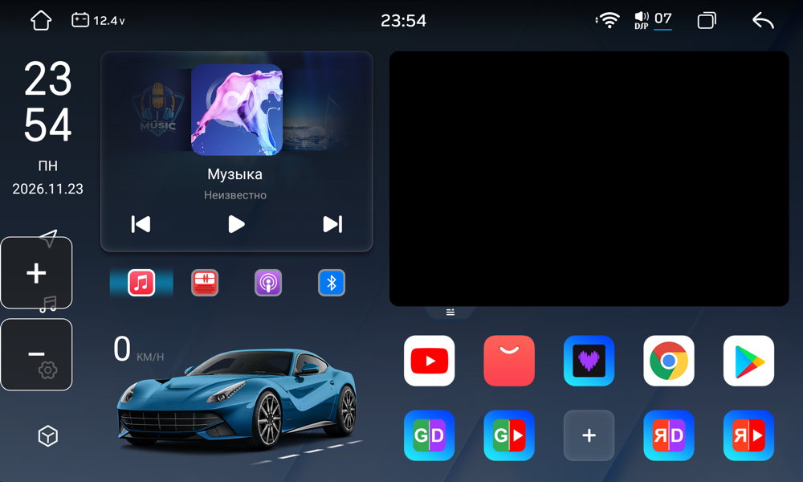
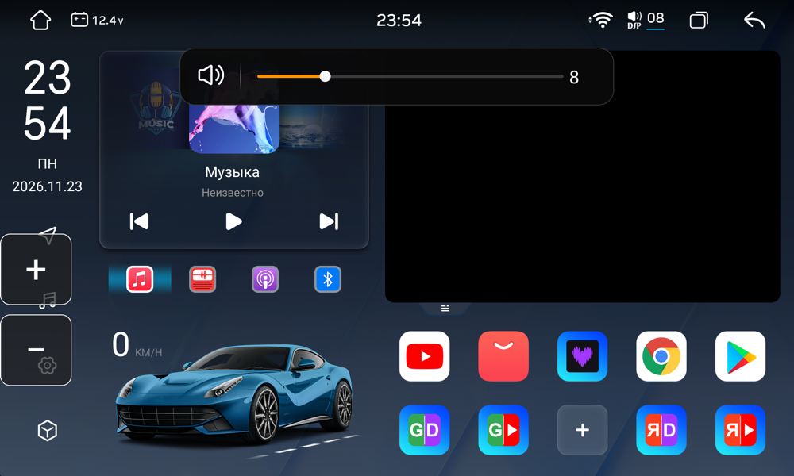

# VolPanel — volume buttons overlay for FYT 7870

Floating "+ / −" volume buttons on top of all apps for FYT UIS7870 head units (Android 13). No root, no PC required.

The firmware's own floating volume buttons don't work in third-party launchers and apps. VolPanel draws its own.

## Screenshots
| Home screen | Volume change |
|---|---|
|  |  |

## Features
- Two square buttons shown on top of all apps.
- Volume is changed through the stock `com.syu.ms` service — the same level as the steering wheel / knob (not Android's `STREAM_MUSIC`).
- Drag the buttons anywhere with your finger; the position is remembered. Tap = one step, hold = auto-repeat.
- Starts automatically on boot (`LOCKED_BOOT_COMPLETED`, ~15 s after power-on).

## Install
1. Download `volpanel.apk` from [Releases](../../releases).
2. Install it, open it once and allow "Display over other apps".

## How it works
```
bindService(Intent("com.syu.ms.toolkit").setPackage("com.syu.ms"))
  → IRemoteToolkit.getRemoteModule(4)
  → IRemoteModule.cmd(0, int[]{arg}, null, null)
```
`arg`: `-1` = vol+, `-2` = vol−, `0..36` = absolute level. The service does not check the caller's signature.

## Build
No Gradle. Requires Android SDK (build-tools 36, platform 35) and a JDK:
```
KS=my.jks KS_PASS=... ./build.sh
```

## Tested on
FYT UIS7870 6/128, Android 13 (build date 2026-05-08), themes launcher_v2 / launcher24. Not tested on other boards. No warranty.

## Limitations
Button size (180 px) is hardcoded in `PanelService.java`.

License: MIT.
